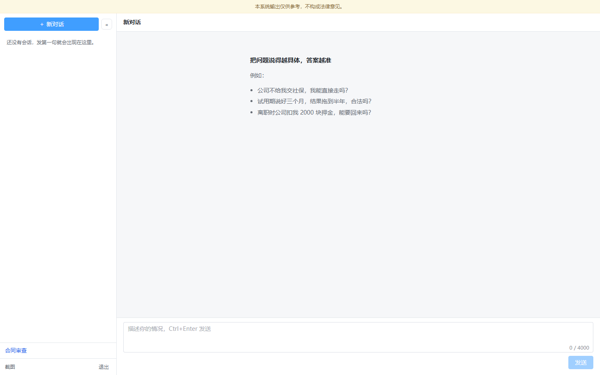

# 演示导演卡（3 分钟）

给要上台的人用的提词卡：每一段只写"说什么 / 点什么 / 屏幕上应该出现什么"。

**下面每个秒数都是 2026-11-16 对线上实测的**，不是估算，也不是本地 dev 的数字：
目标 `https://111.230.152.155:8443`，无头 Chrome 1440×900，qwen-plus，
检索档 `RETRIEVAL_SEMANTIC=on` + `RETRIEVAL_RERANK=true`，本机到腾讯云广州的公网链路，
nginx 已开 gzip（同日 12:36 上线，`deploy/nginx/default.conf`）。
本地 dev 的秒数会好看一倍——那里的 PDF 与 pdfjs 都从磁盘读，一个字节都不过网。
这套口径的重跑命令在文末「数字怎么来的」，每个数字都能一条命令重新量出来。

上台前先跑一次自检，全绿再点开始：

```bash
node web/e2e/preflight.mjs        # 本机演示环境；线上加 --remote
```

### 上台前 60 秒（两条，都是把冷路径先走热）

1. **随便问一句**再进正式演示——第一次提问要冷启动连接池与 SSE 通道，实测比后面慢 0.5 秒。
2. **打开一次要演的那个审查页**再退回去——它会把 `pdf.worker.min-*.mjs`（1.38 MB，gzip 后 403 KB）
   与 `pdfjs-*.js`（328 KB，gzip 后 96 KB）下进浏览器缓存。这两个文件带 30 天 `immutable` 缓存头，
   同一次构建里预热一次就够；不预热，切到审查页要等 1.9 秒才出风险框（见合同审查一节实测）。
   开了 gzip 之后这条从"必须做"降级成"顺手做"——原来不预热是七秒，现在是两秒。

自检线上（PowerShell）：

```powershell
$env:API_BASE='https://111.230.152.155:8443'; $env:WEB_BASE='https://111.230.152.155:8443'
node web/e2e/preflight.mjs --remote
```

自检线上（Git Bash）：

```bash
API_BASE=https://111.230.152.155:8443 WEB_BASE=https://111.230.152.155:8443 node web/e2e/preflight.mjs --remote
```

两项都必须设；只带 `--remote` 会直接报错退出（守卫在 `preflight.mjs`），不会静默去查本机。

---

## 0:00–0:20 开场（不点鼠标）

**说**：

> 输入一句劳动纠纷的口语描述，系统给出可引用的法条原文与行动建议。
> 法条原文只能来自库——596 条，十一部法：《劳动法》107、《劳动合同法》98、《社会保险法》98、《工伤保险条例》67、《保障农民工工资支付条例》64、《劳动争议调解仲裁法》54、《实施条例》38、《劳务派遣暂行规定》29、《女职工劳动保护特别规定》16、《最低工资规定》15、《带薪年休假条例》10，模型不许自己写。

**点**：什么都不点，让屏幕停在对话页的空状态。

**屏幕上应该出现**：左侧会话列表为空，右侧引导文案，输入框在工作台底部。



> 图注：空状态长什么样。左侧底部只有一个入口——「合同审查」进上传页；审查历史已经不单开页面，在上传页左栏，换设备也能找回。

---

## 0:20–1:20 第一问

**点**：输入「公司不给我交社保，我能直接走吗」，回车。

**屏幕上应该出现**（按顺序，这是 11-16 线上实测的：多次采样取中位）：

| 时刻 | 屏幕 |
|---|---|
| 立刻 | 右侧插入占位气泡，状态行「正在检索相关法条…」，左边有一个呼吸圆点 |
| 约 0.3 秒 | 状态行变成「已找到 3 条相关法条，正在分析」，下方出现 3 张法条卡片 |
| 约 0.7 秒 | 状态行整行消失，正文开始逐字出现 |
| 约 7 秒 | 正文结束（354–538 字） |

| 时刻 | 各次实测（秒） | 中位 |
|---|---|---|
| 检索出 3 张卡片 | 0.81 / 0.51 / 0.30 / 0.28 / 0.26 / 0.25 / 0.25 / 0.24 / 0.23 / 0.23 | **0.26** |
| 首个正文字 | 1.32 / 1.16 / 0.92 / 0.71 / 0.68 / 0.67 / 0.63 / 0.59 / 0.59 | **0.68** |
| 正文结束 | 9.63 / 8.09 / 7.58 / 7.51 / 7.16 / 6.75 / 6.51 / 6.12 / 5.56 | **7.2** |

第一行那个 0.81 秒是全新进程的第一次提问：连接池、SSE 通道都是冷的。
所以**上台前先随便问一句**，把这条冷却路径先走一遍；否则第一个数字会比后面慢半秒。

**说**：

> 三张卡片是检索结果：《劳动法》第一百条、《劳动合同法》第三十八条、《实施条例》第十八条。
> 卡片上的条文是库里的原文——它不许模型复述，模型只能写条号。
> 点一下卡片可以展开全文，随时能核对。

**点**（可选）：点第一张卡片展开，展示"查看原文"的链接指向政府网站。

---

## 1:20–1:50 追问（证明有上下文）

**点**：不新开会话，直接在输入框问「那我还能要经济补偿吗」，回车。

**屏幕上应该出现**：同一个会话里追加一轮问答，左侧会话数仍是 1（不是 2）。
回答里出现"经济补偿"的实质内容，而不是重新问一遍"您说的是哪件事"。

**说**：

> 这一轮模型看得到上一轮的问答，不是无状态问答。
> 会话是按用户存的，刷新、换设备都还在。

**实测**：追问一轮中位 7.8 秒（8.70 / 8.60 / 7.99 / 7.84 / 7.53 / 6.76 / 6.21），回答 476–595 字，
每次都提到"经济补偿"。比第一问长的原因是这一轮读得到上一轮的问答，输入 token 更多。

---

## 1:50–2:40 合同审查

**点**：点左侧「上传合同审查」→ 选 `.dev/contract-demo.pdf` → 自动进入审查页。

**屏幕上应该出现**：

| 时刻 | 屏幕 |
|---|---|
| 约 0.2 秒 | PDF 渲染出来，4 页 |
| 立即 | 自动开始审查，面板显示进度与"正在…"的阶段性文案 |
| 约 2 秒 | 右侧出现 7 条风险卡：高风险 6 · 中风险 1 · 低风险 0 |

**这两个秒数是冷缓存（观众第一次进这个页面）的数字，4 次实测，2026-11-16 12:39 开着 gzip 量的：**
渲染到 4 页 0.17 / 1.34 / 0.14 / 0.18 秒（中位 **0.18**），风险框出现 1.79 / 4.09 / 1.70 / 1.91 秒（中位 **1.9**）。
预热过就是 0.1 秒出页、0.95 秒出框。差的这部分全在下载上：`pdf.worker.min-*.mjs` 1.38 MB
压到 403 KB、`pdfjs-*.js` 328 KB 压到 96 KB，单个 worker 的公网下载从 3.3–3.8 秒降到 0.55–1.6 秒
（同一台机器 `curl -H 'Accept-Encoding: gzip' -w '%{size_download} %{time_total}'` 各三次）。
**所以上台前预热一次审查页仍然要做**——省的是那 1.8 秒，不是非做不可，但白等的钱不花。

**点**：点第 1 张卡片「试用期超过法定期限」。

**屏幕上应该出现**：PDF 第 1 页的「第二条」被红框压住，右侧卡片展开详情。

**说**：

> 21 条确定性规则里，这份合同命中 7 条，全是规则判的，不是模型自由发挥：
> 试用期长度（R-PROBATION-MATCH）、试用期工资（R-PROBATION-SALARY）、押金（R-DEPOSIT）、
> 社保（R-NO-SOCIAL-INS）、加班费（R-OVERTIME-FREE）、离职违约金（R-PENALTY-UNLAWFUL）、
> 竞业限制没约定补偿（R-COMPETE-NO-PAY），每条都挂着对应条款的原文。
> 除了试用期、押金、社保这些常见问题，系统还抓到了两条容易被忽略的——
> 离职违约金和竞业限制没有补偿。
> 框的位置来自 PDF 文本层的坐标——模型给的坐标以前是 `[0,0,0,0]`，
> 现在按命中的条款回填 bbox，所以框真的压在那两行字上。

**实测**：上传 0.24 秒（4 页 PDF，服务端解析完才返回，5 次：0.31/0.28/0.24/0.23/0.21）；
审查本身 57 毫秒（服务端 `created_at → updated_at`，5 次：114/60/57/37/28 毫秒）；
页面上看到的那一两秒不是审查，是 pdfjs worker 走公网（gzip 后 403 KB）+ 2 秒轮询间隔
（`POLL_INTERVAL = 2000`，`web/src/views/ReviewView.vue:42`）。

---

## 2:40–3:00 收尾

**点**：刷新页面（F5）。

**屏幕上应该出现**：同一个 URL，7 条风险卡与 7 个框都还在，仍然没有「开始审查」按钮。

**说**：

> 结果从后端来，不是页面状态。刷新还在，关掉浏览器再打开也还在。
> 后端 19 个包 579 个测试全绿，前端 168 条单测，两个都在闸门里跑。

---

## 出问题时的两句兜底话术

不要在台上调试，说一句就往下走：

1. **回答转圈超过 20 秒**：「上游模型这会儿在排队，系统已经在组织回答了；我们先看合同审查，那条链路不依赖模型。」
2. **某一轮报错**：「这一轮上游超时了。它的设计是失败就往下降——检索挂了退回纯关键词，模型挂了会明确说这次没有回答，不会编一段出来。」

备用素材（不用现场跑）：`docs/验收数据.md` 里的检索命中率与延迟对照表。

---

## 不该在台上做的事

- 不要现场注册新账号来"演示注册"——注册限流 5 次/分钟，彩排几次就可能撞上。
- 不要现场上传别的 PDF：扫描件没有文本层，会被明确拒掉（42201），这是设计不是 bug。
- 不要念状态行的秒数："已用时 Ns" 是真计时，念出来会跟着跳。

---

## 数字怎么来的

卡片上每个秒数都能一条命令重新量出来，不需要人工掐表：

```bash
# 默认打线上 111.230.152.155:8443，每项采 3 次；RUNS=5 可加采样
node web/e2e/measure-remote.mjs
# 换目标（本机 dev）：API_BASE=http://127.0.0.1:8080 WEB_BASE=http://127.0.0.1:5173 \
#   node web/e2e/measure-remote.mjs
```

PDF 那两个秒数还受 gzip 影响，顺手复核压缩有没有生效：

```bash
curl -sk -o /dev/null -D - -H 'Accept-Encoding: gzip' \
  https://111.230.152.155:8443/assets/pdf.worker.min-yatZIOMy.mjs | grep -i content-encoding
# 期望：Content-Encoding: gzip
curl -sk -o /dev/null -H 'Accept-Encoding: gzip' -w '%{size_download}B %{time_total}s\n' \
  https://111.230.152.155:8443/assets/pdf.worker.min-yatZIOMy.mjs
# 2026-11-16 实测：403423B / 0.55–1.57s（不压是 1375838B / 3.30–3.78s）
```

口径逐条对齐（脚本注释里也写着，这里给答辩口径）：

| 卡片上的话 | 脚本量的是什么 |
|---|---|
| 约 0.3 秒出 3 张卡片 | SSE 里第一个 `tool_call`（status=ok）的到达时刻——状态行就是被它切走的 |
| 约 0.7 秒开始出字 | 第一个非空 `delta` 帧 |
| 约 7 秒正文结束 | `done` 帧 |
| 追问一轮 | 同一会话第二轮从发出到 `done`；脚本会断言 session_id 没变 |
| 上传 0.24 秒 | `POST /files` 到响应返回（服务端解析完才回） |
| 审查 57 毫秒 | 不是脚本量的：`docker exec deploy-mysql-1 mysql ...` 取 `TIMESTAMPDIFF(created_at, updated_at)`，脚本另有一列「到 succeeded」是 100ms 轮询口径 |
| PDF 0.2 秒 / 框 2 秒 | 无头 Chrome 新导航到 `.page` 满 4 个、到 `.mark` 出现第一个（gzip 已开） |

脚本自己的两条硬规矩：每项取中位数（单次会被上游排队、TLS 握手、本机 GC 干扰）；
任何一步失败都非 0 退出，审查页控制台一旦报错就判失败——换构建之后前端没跑通，
页数照样能出来，光看秒数看不出来。
