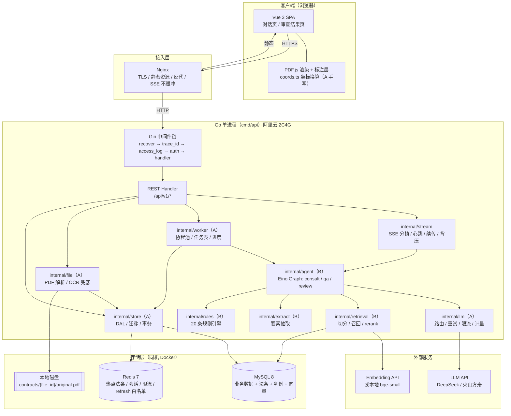
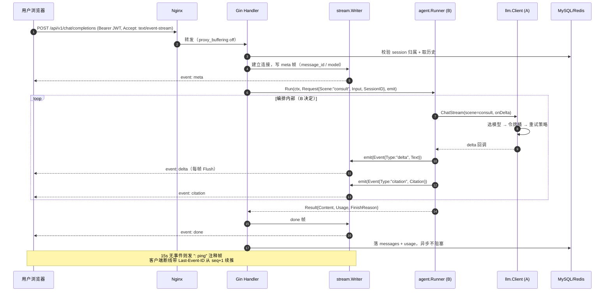
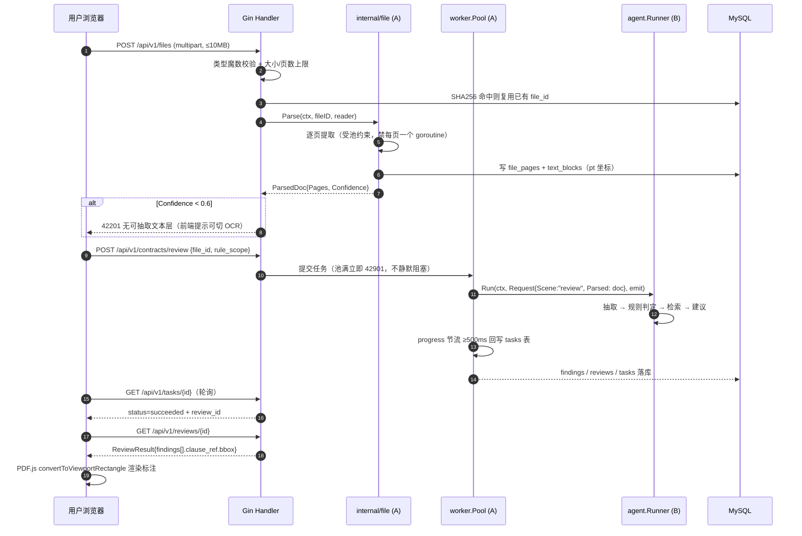
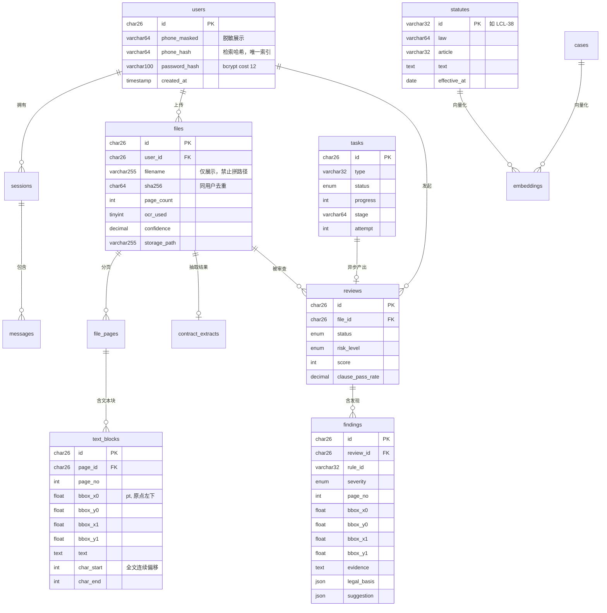

# 劳动法 AI 顾问系统 · 项目大纲与技术选型

> 依据：`docs/劳动法AI顾问系统(1)(7)(1).docx`（策划书原件）+ 现有 `internal/port/` 已定稿代码
> 编写日期：2026-11-06
> 读者：A（后端）、B（Agent）、指导老师

> **⚠️ 修订（2026-11-06 晚）**：硬件与周期已确定变更——
> ① 服务器为阿里云 e 实例 **2 核 2G**（本文原按 2 核 4G 假设，内存预算需下调）；
> ② 套餐**不含公网带宽**，需另买且 80/443 未备案会被阻断；
> ③ **放弃策划书排期，改为 1 个月从零交付**。
> 本文的架构与选型结论仍然成立，但**工期、性能阈值、功能范围以 [`docs/冲刺计划_1个月.md`](冲刺计划_1个月.md) 为准**。本文 §5 的 8 周排期仅作完整产品参考。

**标注约定**：`【事实】` = 策划书或代码里已有；`【假设】` = 我按约束推断、需你确认；`【建议】` = 我的判断。

---

## 0. 现状校准：先看清我们在哪

这一节不写清，后面所有工期都是假的。

| 项 | 事实 | 影响 |
|---|---|---|
| 项目性质 | 【事实】校级大创，创新训练项目，预算 5000 元 | 不追求商用，但要有可演示的完整闭环 |
| 团队 | 【事实】2 人：A 后端、B Agent；另有法学同学审核规则、指导老师黄斌 | 没有前端专职，前端靠 AI 生成 + A 验收 |
| 策划书时间线 | 【事实】2026.4–6 开发、7–10 测试、**2026.11–12 总结与验收** | **今天 11-06，正处在最后的验收阶段** |
| 代码现状 | 【事实】`internal/port/` 五 interface + 错误码 + 模型 + 78 例测试已完成并合入 | 地基在，业务代码尚未开始 |
| 部署目标 | 【事实】阿里云 2 核 | 单机承载 API + MySQL + Redis，内存是硬约束 |
| 技术路线 | 【事实】Vue + Pinia + axios + PDF.js + Tesseract.js；Go + Gin + Eino + Redis + MySQL | 已写进申报书，**不宜推翻**，否则验收时对不上申报内容 |

**结论**：策划书排期已经落后于实际（业务代码 0 行，只剩约 8 周）。这份大纲按"**8 周内做出可演示闭环**"重排，砍掉一切不影响验收的功能，而不是按"理想产品"排。

---

# 一、项目大纲

## 1. 项目概述与目标

### 1.1 一句话定位

【事实】面向劳动者与企业 HR 的**劳动法垂直 AI 顾问**：能答（多条款联动的法律咨询），能审（劳动合同合规审查 + 条款优化建议），并用**"法律合规性 + 经济合理性"双维度**给出结论。

### 1.2 目标用户与场景

| 用户 | 核心痛点 | 系统给的答案 | 优先级 |
|---|---|---|---|
| 劳动者 | 不知道自己的情况算不算违法、能拿多少钱、该找谁 | 维权路径 + 法条依据 + 经济补偿计算 | P0 |
| 企业 HR / 中小企业主 | 合同条款是否踩线、试用期/竞业限制怎么写 | 风险等级 + 逐条修改建议 | P0 |
| 法学学生 / 法律从业者 | 查条文与判例效率低 | 语义检索 + 判例胜诉率 | P2 |

【建议】答辩叙事以**劳动者维权**为主线（策划书强调"弱势群体维权"的社会价值），企业审查作为第二场景。两个场景共用同一套解析 + 规则 + 检索能力，边际成本低。

### 1.3 成功标准（可验收指标）

这些数字直接写进验收 PPT，每一项都能当场演示或跑命令验证。

| 维度 | 指标 | 验收方式 |
|---|---|---|
| 功能完整性 | 咨询、上传、解析、审查、历史 5 条链路全部走通 | 现场演示 |
| 咨询质量 | 20 条评测问题中，回答**含正确法条编号**的比例 ≥ 80% | 评测脚本跑批 |
| 引用可信 | 回答里每条法条引用都能追溯到库内条文，**零编造** | 抽查 20 条 |
| 审查准确性 | 50 份标注合同样本上，规则命中 **Precision ≥ 85%、Recall ≥ 75%** | 人工标注对照 |
| 坐标精度 | "试用期三个月"所在 block 的 BBox 与人工标注误差 **≤ 2pt** | 标注层截图比对 |
| 性能 | SSE 首字节 **< 1.5s**；合同审查同步接口 **P95 < 15s** | wrk / curl 计时 |
| 稳定性 | 连续 100 次咨询 + 20 次审查无崩溃、无 goroutine 泄漏 | 压测 + `runtime.NumGoroutine()` 断言 |
| 安全 | 越权访问返回 403、SQL 注入与 XSS 探测无效果、key 不在仓库与日志 | 安全测试清单 |
| 工程规范 | `go build/vet/test` 全绿，覆盖率 ≥ 60%，CI 通过 | GitHub Actions |

## 2. 需求拆解

### 2.1 核心功能清单（MoSCoW）

**M — Must have（不做就交不了差）**

| # | 功能 | 说明 | 归属 |
|---|---|---|---|
| M1 | 用户注册 / 登录 / JWT | bcrypt cost 12，access 2h + refresh 30d | A |
| M2 | 劳动法问答（consult） | 多条款联动，SSE 流式输出 | B 编排 / A 传输 |
| M3 | 合同上传 | PDF ≤10MB、≤100 页，SHA256 去重 | A |
| M4 | PDF 解析（文本块 + 坐标） | pt / 原点左下 / y 轴向上，跨页连续偏移 | A |
| M5 | 合同要素抽取 | 期限、薪酬、试用期、工时、社保、竞业、违约 | B |
| M6 | 规则判定 + 风险标注 | 20 条规则，分高中低三级 | B |
| M7 | 审查结果页（含 PDF 标注层） | 点击 finding 高亮合同原文 | A（手写坐标换算） |
| M8 | 会话历史 | 列表 + 回溯 | A |
| M9 | 统一错误码 + 响应包络 | 14 条错误码 | A（已完成） |
| M10 | 部署上线 | 阿里云 2 核，一条命令起 | A |

**S — Should have（有余力就做，明显加分）**

| # | 功能 | 价值 | 归属 |
|---|---|---|---|
| S1 | 法条语义检索（RAG） | 咨询质量从"背法条"升级到"查得到" | B |
| S2 | 引用卡片（citation 事件） | 答辩最强的可视化：答案旁边挂着条文原文 | A + B |
| S3 | 异步审查 + 任务进度 | 长合同不卡界面 | A |
| S4 | 审查报告导出 PDF | 可交付物，演示有仪式感 | A |
| S5 | 判例推荐 + 胜诉率 | 策划书"动态法律知识库"的落点 | B |
| S6 | 热点法条 Redis 缓存 | 策划书明确要求，且是性能证据 | A |

**C — Could have（加分项，时间允许才做）**

| # | 功能 | 说明 |
|---|---|---|
| C1 | 维权路径可视化 | 仲裁流程时间轴 + 证据清单生成 |
| C2 | 经济性分析（P2） | 违法解除赔偿金测算、用工成本对比 |
| C3 | 多轮追问与上下文改写 | 需要 query rewriting |
| C4 | 报告分享链接 | 只读 token |

**W — Won't have（本轮明确不做，写进"未来工作"）**

企业多租户 / 团队协作、移动 App、语音输入、真实律师接入、向量数据库集群、模型微调（5000 预算不够，且 2 核训不动）、Word 文档审查（只做 PDF）。

### 2.2 非功能需求

| 类别 | 要求 | 为什么是这个数 |
|---|---|---|
| 性能 | SSE TTFB < 1.5s；咨询首字 < 3s；同步审查 P95 < 15s；静态接口 P95 < 200ms | 2 核机器上，超过这个数就是排队排出来的，先修架构再加机器 |
| 并发 | 20 路并发 SSE + 5 路并发审查 | 【假设】校园演示 + 小范围内测的量级，2 核现实上限 |
| 容量 | 注册用户 1000、法条 500 条、判例 500 条、合同 200 份、消息 5 万条 | 【假设】一学期内的真实数据量 |
| 可用性 | 演示期 99%（允许计划内重启） | 单机没有高可用可言，不要写 99.9% |
| 安全 | 传输 HTTPS；密码 bcrypt；身份证/手机号 AES-GCM 加密存储 + 日志脱敏；上传文件类型与大小双重校验 | 劳动法场景天然带敏感个人信息，泄漏是硬伤 |
| 可扩展 | 新增一条审查规则 = 加一个文件不改引擎；新增一个 LLM 供应商 = 只改 `internal/llm` | 用 interface 隔离，2 人团队改不动大架构 |
| 可观测 | 结构化日志 + trace_id 全链路 + `/metrics` + 关键告警 | 线上出问题要能在 5 分钟内定位 |
| 成本 | LLM 日预算上限硬闸，超限降级到便宜模型 | 预算 5000 元，其中 API 是大头 |

## 3. 系统架构设计

### 3.1 整体架构



**关键设计点**

1. **单进程双角色**：`cmd/api` 与 `cmd/worker` 独立二进制但共享 `internal/config` 装配函数。开发期可以 `go run ./cmd/api` 一个进程跑全部（内嵌 worker），部署期拆开，避免早期就上消息队列。
2. **B 的代码不碰 HTTP**：`agent.Runner` 只吐 `Event`，SSE 帧格式由 A 的 `internal/stream` 决定。这是两人能并行的前提。
3. **坐标只在两处存在**：A 产出（`internal/file`），前端渲染层消费（`coords.ts`），B 全程只传 `block_id + char_span`。
4. **向量不进向量库**：几千条 embedding 存 MySQL JSON 列，Go 进程内存里算余弦相似度。2 核机器上 Milvus 是负资产。

### 3.2 模块划分与职责

| 目录 | 职责 | 归属 | 当前状态 |
|---|---|---|---|
| `cmd/api` `cmd/worker` | 进程入口、依赖装配、优雅关闭 | A | 待建 |
| `internal/config` | 环境变量 → 结构体 + Validate | A | 待建 |
| `internal/api` | 路由、中间件、DTO、错误映射 | A | 待建 |
| `internal/stream` | SSE 分帧、心跳、Last-Event-ID 续传、背压 | A | 待建 |
| `internal/llm` | 多模型路由、重试、限流、token 计量、成本闸 | A | 待建 |
| `internal/file` | PDF 解析、OCR 兜底、页与块落库 | A | 待建 |
| `internal/store` | MySQL/Redis DAL、迁移、事务 | A | 待建 |
| `internal/worker` | 协程池、任务表、进度回写、优雅关闭 | A | 待建 |
| `internal/agent` | Eino Graph 编排（consult / qa / review） | B | 待建 |
| `internal/prompt` | prompt 模板与版本管理 | B | 待建 |
| `internal/retrieval` | 切分、embedding、召回、rerank | B | 待建 |
| `internal/extract` | 要素抽取 + 置信度 + 缺失字段 | B | 待建 |
| `internal/rules` | 20 条规则 + 引擎 + 单测 | B | 待建 |
| `eval` `data` | 评测集、法条/判例数据 | B | 待建 |
| `internal/port` | **唯一共用**：五 interface、DTO、错误码 | A+B | ✅ 已完成 |
| `web/src/utils/pdf/coords.ts` | 坐标换算（AI 禁区） | A | 待建 |
| `contract/openapi.yaml` | 接口真相源 | A | 待建 |
| `deploy/` | Dockerfile、compose、Makefile、runbook | A | 待建 |

### 3.3 关键数据流

**流程一：劳动法咨询（SSE 流式）**



**流程二：合同审查（上传 → 解析 → 审查）**



## 4. 数据模型设计要点

### 4.1 ER 图



### 4.2 设计要点

| 决策 | 选择 | 理由 |
|---|---|---|
| 主键 | **CHAR(26) ULID** | 带时间前缀，`ORDER BY id` 即时间序；不暴露自增数量；跨表拼接无碰撞。代价是 26 字节索引，可接受 |
| 软删除 | 只 `users` / `sessions` 需要 `deleted_at` | 合同与审查结果必须留审计痕迹，**禁止物理删除**；法条是只读表不需要 |
| 向量存储 | `embeddings` 表 + JSON 列（float 数组） | 5000 条 × 512 维 ≈ 10MB，能全量进内存算 cosine。引 Milvus 在 2 核上是负资产 |
| 大文本 | `text_blocks.text` 用 `TEXT`，正文不进 `files` | 避免 `SELECT *` 时把几十 MB 正文拖进内存 |
| 敏感字段 | `phone_hash`（SHA256+盐，唯一索引）用于登录检索；`phone_masked` 用于展示；真实手机号与身份证用 AES-GCM 存 `*_enc` 列 | 既要能查，又不能明文。**日志与 error 一律禁止出现原文** |
| 迁移 | 自研迁移器：`go:embed` 打包 `migrations/*.sql`，up/down 成对，启动时 `GET_LOCK` 防并发 | 不用 golang-migrate——它带进一整棵依赖树，而本项目只需要"按序号执行 + 记版本"；也不用 GORM AutoMigrate，它不生成 down，回滚时只能手写 |
| 索引 | `sessions(user_id, updated_at)`、`messages(session_id, created_at)`、`files(user_id, sha256)` 唯一、`findings(review_id, severity)`、`tasks(status, updated_at)`、`statutes(law, article)` 唯一 | 每条索引对应一条真实查询，没有查询支撑的索引一律不加（写放大） |
| 时间 | 全库 `DATETIME(3)` + UTC 存储 | 地方政策有生效日期，毫秒精度够；UTC 存储避免跨时区混乱 |

## 5. 开发计划

**前提**：~~今天是 2026-11-06，验收期 12 月底，可用约 8 周~~ → **已改为 3 周冲刺，见 [`docs/冲刺计划_1个月.md`](冲刺计划_1个月.md)**。

**官方验收时间线（产品经理 2026-11-06 发布）**：

| # | 截止 | 交付物 |
|---|---|---|
| ① | 11/07 24:00 | 产品设计、技术选型、代码仓库搭建 |
| ② | 11/14 24:00 | 开发一半，项目初步可部署 |
| ③ | 11/21 24:00 | 功能基本完成，可正常使用 |
| ④ | 11/29 15:00 | PPT（7 分钟演讲 + 3 分钟演示）+ 体验网站，基本无 bug |

> **开发方式**：实现主要由 AI 生成，人负责定契约、审实现、跑通链路、部署排障与答辩讲解。四条硬规矩（跑过再提交 / 讲不出就不算懂 / 测试是闸门 / 红区人写）见 [`docs/冲刺计划_1个月.md`](冲刺计划_1个月.md) §0.5。**评估工作量时按"理解 + 联调"算，不按敲代码算。**

下面这张 8 周表仅作「完整产品」参考：如果后续还有第二个月，按它补 M4 以后的能力。**真实排期、砍单清单、2G 内存预算全部在冲刺计划里，那份才是指挥文件。**

### 5.1 里程碑

| 里程碑 | 时间 | 交付物 | 验收标准 | A 人日 | B 人日 |
|---|---|---|---|---|---|
| **M0 地基** ✅ | 已完成 | `internal/port` 五 interface + 错误码 + 模型 + 测试 | `go test ./...` 全绿，覆盖率 92% | 3 | 1（评审） |
| **M1 能起来** | 11/06–11/12 | `internal/config`、`cmd/api`、Gin 骨架、`/healthz` `/readyz`、统一包络、`contract/openapi.yaml` v1 | `go run ./cmd/api` 后 `curl /healthz` 返回 200；B 能在 3 分钟内跑通 5 个 mock 接口 | 4 | 1 |
| **M2 咨询通** | 11/13–11/20 | `internal/llm`（路由/重试/限流/计量/FakeClient）、`internal/stream`（分帧/心跳/续传）、对话页 | `curl -N` 看到逐帧输出，TTFB < 1.5s；无 key 时 FakeClient 能跑通全链路 | 6 | 3 |
| **M3 审查通** | 11/20–11/27 | `internal/file`（解析+坐标+OCR 兜底）、`internal/worker`、上传页、结果页、标注层 | "试用期三个月" BBox 误差 ≤2pt；加密 PDF 返回 41501 不 panic | 7 | 4 |
| **M4 判定准** | 11/27–12/04 | `internal/rules` 20 条、`internal/extract`、`internal/retrieval`、法条/判例入库 | 50 份样本 Precision ≥85%、Recall ≥75% | 3（前端验收+数据脚本） | 8 |
| **M5 上线** | 12/04–12/11 | 阿里云 2 核部署、Docker Compose、CI、监控、缓存 | 公网可访问，`/metrics` 有数，Redis 停掉接口不 500 | 5 | 1 |
| **M6 打磨** | 12/11–12/20 | 安全测试（越权/注入/文件类型绕过）、压测、评测 160 条、修 bug | 安全清单全过；100 并发咨询无泄漏 | 4 | 4 |
| **M7 收尾** | 12/20–12/31 | 演示动线、架构图、PPT、报告、runbook | 全流程 10 分钟内演示完毕 | 3 | 3 |
| **合计** | | | | **35** | **25** |

### 5.2 工期结论

A 需 35 人日，B 需 25 人日。8 周 × 每周 20h（2.5 人日）≈ 20 人日/人——**A 超支 15 人日，B 基本持平**。

【建议】三条减负路径，按优先级：

1. **砍 S/C 级功能**：S4（报告导出）、S5（判例）、C1–C4 全部延后，省约 8 人日。
2. **前端 AI 生成 + A 只写红区**：除 `coords.ts` 与 SSE 解析外全部交给 AI 生成，A 只做验收（省约 6 人日）。
3. **OCR 降级**：Tesseract 兜底只做"能跑通"级别，不调优（省约 3 人日）。

若仍超支，**砍审查规则的行业分支**（金融/制造业个性化规则），只保留通用规则——那是策划书里的"预期成果"之外的加分项。

## 6. 风险识别与应对

| 风险 | 类型 | 概率 | 影响 | 应对 |
|---|---|---|---|---|
| 8 周做不完闭环 | 进度 | **高** | 验收失败 | 每两周砍一次范围；M2/M3 是生命线，其余可延；先做纵向切片（一条链路通），不做横向铺开 |
| 2 核内存打爆（MySQL+Redis+Go 全塞一台） | 技术 | 高 | 服务 OOM 重启 | MySQL `innodb_buffer_pool_size=256M`、Redis `maxmemory 128M` + LRU、Go 保持默认 GOGC（不显式设置）+ 容器内存上限；提前压测 |
| LLM API 费用超预算 | 成本 | 中 | 演示中断 | 日预算硬闸 + 超限降级便宜模型；评测用缓存回放；开发期一律走 FakeClient |
| 坐标错位（最隐蔽） | 技术 | 中 | 演示时标注全歪 | `TextBlock.Valid()` 在写入/回传/渲染三处共用；样本合同人工标注 5 处做回归测试 |
| 规则误报率高，答辩被问穿 | 质量 | 中 | 可信度受损 | 规则口径由法学同学终审，A/B 都不定；误报逐条留档并归因（抽取错 / 规则错 / 法条过期） |
| 两人接口认知不一致 | 协作 | 中 | 联调返工 | `internal/port` 已定稿，只加不改；每天 10 分钟站会同步；变更必须出变更单 |
| 阿里云安全组/备案/HTTPS 卡住 | 运维 | 中 | 无法公网演示 | 提前一周办；备选：本机 + 内网穿透（frp/ngrok）演示，云上作为"已部署"证据 |
| 大创中期检查材料缺失 | 流程 | 低 | 影响结题 | 每个里程碑留截图 + commit 记录 + 测试报告 |

## 7. 测试与上线策略

### 7.1 测试金字塔

| 层次 | 工具 | 覆盖目标 | 谁写 |
|---|---|---|---|
| 单元测试 | `go test` + 表驱动 | 错误码映射、坐标校验、状态机、规则判定、重试策略；覆盖率 ≥60% | A + B |
| 契约测试 | `openapi.yaml` + `prism mock` | 前端只按契约写，mock 能跑通全部接口 | A |
| 集成测试 | `testcontainers-go` 或 Docker Compose + `go test` | 上传→解析→审查→落库全链路；Redis 宕机降级 | A |
| 评测（灵魂） | `eval/` 跑批脚本 | 160 条问题 + 50 份标注合同，输出 Precision/Recall/引用准确率 | B 主导 |
| 前端测试 | `vue-tsc` + `vitest` + `playwright` | 页面渲染、SSE 增量拼接、标注层坐标对齐（截图比对） | A 验收 |
| 性能测试 | `wrk` / `k6` | 20 并发 SSE、5 并发审查、100 QPS 静态接口 | A |
| 安全测试 | 手工清单 | 越权、SQL 注入、XSS、文件类型绕过、prompt 注入、JWT 伪造 | A |

### 7.2 上线流程

```
本地 dev（FakeClient，零成本）
  → CI（build/vet/lint/test -race）
    → 预发（阿里云同配置，真模型，小流量）
      → 生产（蓝绿：新容器健康检查通过后切 Nginx upstream）
```

**回滚**：镜像保留最近 3 个 tag，`docker compose up -d --force-recreate` 切回上一版；数据库迁移必须有 `down` 脚本，回滚前先 `mysqldump` 快照。

**灰度**：【建议】单机 + 2 人团队不做真灰度，用"白名单用户先开"的方式降低风险。

## 8. 运维与监控要点

| 项 | 方案 | 关键指标 |
|---|---|---|
| 健康检查 | `/healthz`（不查依赖）+ `/readyz`（查 MySQL/Redis） | 容器 healthcheck 用 `readyz` |
| 指标 | `/metrics` Prometheus 格式 | QPS、P95 延迟、错误率、goroutine 数、worker 队列深度、LLM 调用数与 token 消耗（按 scene） |
| 日志 | zap 结构化 + `trace_id` 贯穿 | 禁止记录合同原文、手机号、身份证、API key |
| 告警 | 云监控 + 简单阈值脚本 | 5xx 比例 >5%、readyz 连续失败 3 次、日 token 超预算、磁盘 >80% |
| 备份 | MySQL 每日 `mysqldump` + 上传文件目录同步 | 保留 7 天；演练一次恢复 |
| 成本 | LLM 用量日报 | 每日 token / 折算金额，超 80% 预算发提醒 |

**2 核机器上的取舍**：不装完整 Grafana + Loki 全家桶（内存不够）。用 `/metrics` + 阿里云云监控 + `docker logs` 到文件 + `lumberjack` 滚动，够用且轻。

---

# 二、技术栈选型

> 总原则：【事实】申报书已写明 Vue + Go + Gin + Eino + Redis + MySQL，**这些不动**。下面的选型是在此基础上补齐缺口，并把"为什么"写清楚，答辩时被问"为什么不用 XX"能答上来。

## 1. 前端

| 项 | 推荐 | 为什么 | 备选与取舍 |
|---|---|---|---|
| 框架 | **Vue 3 + `<script setup>` + TypeScript** | 【事实】申报书指定 Vue；组合式 API 对 SSE 增量拼接、PDF 标注层这类"命令式 + 响应式混合"场景比 Options API 干净 | React：生态更大但对 2 人非前端团队的学习成本高；Svelte：编译产物小但招不到人、AI 训练样本少 |
| UI 库 | **Element Plus** | 中文文档、表格/上传/步骤条开箱即用，后台型界面省一半工时 | Naive UI：类型更好但组件少；Tailwind 手搓：自由度高风险大；Ant Design Vue：重 |
| 状态管理 | **Pinia** | 【事实】申报书指定；TS 推断好，模块化天然分 store | Vuex：已被官方标记维护模式；直接组合式函数：跨页共享状态时会散 |
| 请求层 | **axios + 拦截器**（普通接口）/ **fetch + ReadableStream**（SSE） | 【事实】申报书指定 axios。但 SSE **必须**用 fetch：`EventSource` 不支持 POST、不支持自定义 `Authorization` 头 | `@microsoft/fetch-event-source`：可用但要审源码；原生 `EventSource`：只能 GET + 无法带 token（不可用） |
| 构建 | **Vite 5** | 冷启动秒级，HMR 快，2 人迭代频率高 | webpack：慢；Rspack：快但生态新，出问题没人答 |
| PDF 渲染 | **pdf.js（PDF.js 官方构建）+ 自写标注层** | 【事实】申报书指定；`viewport.convertToViewportRectangle()` 是坐标换算唯一正确入口 | pdfium-wasm：性能好但 API 生疏；服务端渲染成图 + 前端画框：失去文本选择，且服务端 CPU 扛不住 |
| OCR | **Tesseract.js（前端兜底，仅在 42201 后触发）** | 【事实】申报书指定；放前端跑，省 2 核 CPU | 后端 tesseract-ocr CLI：占 CPU、要装语言包；云 OCR API：准但收费 |
| 图表 | **ECharts** | 风险等级分布、条款合规率，中文文档全 | Chart.js：够用但中文排版弱 |

## 2. 后端

| 项 | 推荐 | 为什么 | 备选与取舍 |
|---|---|---|---|
| 语言 | **Go 1.22+** | 【事实】申报书指定；单二进制部署、goroutine 处理 SSE 与协程池天然合适、2 核机器上内存占用低 | Python：Agent 生态更好但 2 核 + 高并发 SSE 吃亏；Java：太重，2 人团队启动慢 |
| Web 框架 | **Gin** | 【事实】申报书指定；中间件链清晰、SSE 用 `c.Writer.Flush()` 直接可控 | Echo：几乎等价，无迁移理由；chi：更轻但生态小；Fiber：基于 fasthttp，与标准库 `http.Handler` 生态不兼容（Prometheus、SSE 中间件会踩坑） |
| Agent 框架 | **字节 Eino** | 【事实】申报书指定，且是本项目的"技术亮点"——答辩要讲的就是 Eino 的 Graph 编排 | LangChainGo：社区大但抽象重、调试难；自研：可控但要重造工具调用/流式/重试轮子 |
| API 风格 | **REST + SSE** | 前端是 AI 生成，REST + OpenAPI 契约是唯一能让 AI 写对的方式；流式必须 SSE | GraphQL：流式订阅要额外搭 WS，前端 AI 生成容易写错；gRPC：浏览器支持要 grpc-web 代理，纯增负担 |
| 配置 | **`os.Getenv` + 结构体 + `Validate()`** | 零依赖、启动即校验、缺项直接报出变量名 | viper：功能全但隐式行为多（大小写、默认值、配置文件优先级），排障成本大于收益；koanf：同上 |
| 日志 | **zap**（或标准库 `log/slog`） | 结构化 + 低分配；`slog` 是标准库，零依赖，Go 1.21+ 可直接用 | logrus：已进维护模式；zerolog：更快但 API 风格特立 |
| 数据库驱动 | **`database/sql`（标准库，没有 sqlx）** | 不用 ORM：审查场景的查询是"多表 join + 聚合 + JSON 列"，ORM 生成的 SQL 不可控，2 核机器上一条烂 SQL 就打满 CPU | sqlx：只是少写几行 `Scan`，不值得多一个依赖；GORM：AutoMigrate 诱人但没有 down 迁移，且隐藏 N+1；ent：类型安全但代码生成器学习成本 |
| 迁移 | **自研（`internal/store/migrate.go`）** | `go:embed` 打包 SQL，按序号执行、`schema_migrations` 记版本、`GET_LOCK` 防多实例并发 | golang-migrate：功能全但依赖树大；goose：等价；Atlas：功能强但对本项目过重 |

## 3. 数据库

| 项 | 推荐 | 为什么 | 备选与取舍 |
|---|---|---|---|
| 关系库 | **MySQL 8.0（utf8mb4）** | 【事实】申报书指定；JSON 列可用（存 legal_basis、suggestion、embedding）、窗口函数够用、云上 RDS 便宜 | PostgreSQL：JSONB 与向量扩展更强，但团队已按 MySQL 写接口，且云 RDS 同配置贵；SQLite：单机够用但并发写差，且答辩时"用 SQLite"观感弱 |
| 缓存 | **Redis 7** | 【事实】申报书指定；热点法条缓存是申报书明确写的能力，也是性能证据 | Memcached：只有 KV，没有 TTL 续期/集合/单飞配合；进程内缓存：多实例失效、重启丢失 |
| 向量库 | **不引入**（MySQL JSON + 进程内 cosine） | 5000 条 × 512 维 ≈ 10MB，Go 里算一次全量相似度 <20ms。2 核上 Milvus/Qdrant 单容器就要 500MB+ | Milvus：过重；Qdrant：单二进制可行但要额外内存；pgvector：需要换库 |
| 读写分离 | **暂不做** | 【假设】1000 用户、20 并发，单库足够。读写分离在 2 核上只会增加运维复杂度 | 一旦 QPS >300 或主库 CPU 持续 >70% 再考虑 |
| 分库分表 | **不做** | 数据量：消息 5 万条/学期、合同 200 份。分表收益为负 | 触发条件写清楚：单表 >5000 万行或单库 >200GB 才谈 |
| 向量维度 | 512 或 1024（按 embedding 模型） | 【建议】选便宜的 API embedding，512 维够用且省内存 | 1024 维精度略好，内存翻倍 |

## 4. 中间件

| 项 | 推荐 | 为什么 | 备选与取舍 |
|---|---|---|---|
| 消息队列 | **不引入**，用 `tasks` 表 + 协程池 | 审查任务是"提交后轮询进度"，不需要削峰；RabbitMQ/Kafka 在 2 核上是纯负担 | asynq（Redis 队列）：功能好，但申报书写的是"Go Routine 实现高并发调度"，自己写更贴合答辩叙事；Kafka：绝对不需要 |
| 全文检索 | **MySQL `LIKE` + 应用层口语归一** 起步 | 法条仅 205 条，`LIKE` 全表扫也是毫秒级；"加班费"这类口语靠 `internal/retrieval` 的归一表映射到"延长工作时间"，比数据库分词更准 | 全文索引（ngram）：中文分词质量不稳定，还要额外维护索引；Elasticsearch：单容器 1GB 内存，2 核装不下；Meilisearch：轻（100MB）但中文分词一般，可作为 P2 备选 |
| 对象存储 | **本地磁盘**（`storage/contracts/{file_id}/`） | 200 份 PDF 最多几 GB，云盘够；申请 OSS 要走审批 | 阿里云 OSS：免运维、可 CDN，但内网流量与费用；MinIO：本地对象存储，多一个容器 |
| 缓存中间层 | 无 | 单机无 CDN 需求 | — |

## 5. 基础设施与部署

| 项 | 推荐 | 为什么 | 备选与取舍 |
|---|---|---|---|
| 云 | **阿里云 2 核 4G ECS**（已定） | 【事实】用户指定 | 腾讯云/华为云：等价；Serverless（函数计算）：SSE 长连接 + 冷启动是硬伤，不能用 |
| 容器化 | **Docker + Docker Compose** | 一条 `make up` 起 MySQL/Redis/api/worker/nginx；2 人团队不需要 K8s | K8s：运维成本远超收益；裸机 systemd：环境不一致，B 的机器上跑不起来 |
| 反向代理 | **Nginx** | SSE 必须 `proxy_buffering off`、`proxy_read_timeout 300s`、`X-Accel-Buffering: no`；同时托管 Vue 静态资源 | Caddy：自动 HTTPS 很香，但 SSE 配置文档少；直接用 Gin 托管静态：单进程耦合 |
| CI/CD | **GitHub Actions**（免费额度） | 私有仓库 2000 分钟/月够用；跑 build/vet/lint/test -race + 构建镜像 | 阿里云效：国内快但与 GitHub 仓库割裂；GitLab CI：要自建 runner |
| 镜像仓库 | **阿里云 ACR 个人版**（免费） | 与 ECS 同区域，拉取快 | Docker Hub：国内拉取不稳 |
| 反向隧道（备选） | frp / Cloudflare Tunnel | 若公网 IP/备案卡住，用隧道先演示 | ngrok：免费版域名随机 |

## 6. 监控与日志

| 项 | 推荐 | 为什么 | 备选与取舍 |
|---|---|---|---|
| 指标 | **`promhttp` 暴露 `/metrics`** | 一个依赖、几十行代码；答辩时能展示"调用了多少次 LLM、消耗多少 token" | OpenTelemetry：标准但对 2 人团队过重 |
| 可视化 | **阿里云云监控 + 少量自建脚本** / 或单机 Prometheus（不装 Grafana） | 2 核内存有限，Grafana 又要 200MB | Grafana 全套：内存不够；自建看板：用 `/metrics` 的文本输出足够演示 |
| 日志 | **zap JSON → 文件（lumberjack 滚动）+ `docker logs`** | 结构化、可 grep、带 trace_id | ELK：内存 2GB 起，装不下；Loki：轻些但也要 200MB+ |
| 链路追踪 | **trace_id 贯穿日志**（不引 Jaeger） | 单机单进程，一个 id 足够定位 | Jaeger/Tempo：多实例才有价值 |
| 告警 | **云监控阈值 + 定时脚本查 `/readyz`** | 够用 | Prometheus Alertmanager：多一个组件 |

## 7. 安全与认证

| 项 | 推荐 | 为什么 | 备选与取舍 |
|---|---|---|---|
| 认证 | **JWT HS256**（access 2h + refresh 30d，refresh 存 Redis 白名单） | 无状态、前端好处理；白名单解决"登出即失效" | Session + Cookie：SSRF/CSRF 要额外处理，SPA 跨域麻烦；OAuth2：本项目没有第三方登录需求 |
| 密码 | **bcrypt cost 12** | 自适应成本，抗 GPU 暴力破解 | argon2id：更强但 Go 标准库没有，需 `golang.org/x/crypto`（可接受）；MD5/SHA：禁止 |
| 权限模型 | **基于资源归属的 RBAC-lite**（user → 自己的 file/review/session） | 只有"本人"一种角色，RBAC 全套是过度设计 | Casbin：策略引擎强大，但本项目 3 条规则用不上 |
| 传输 | **HTTPS（阿里云免费证书）+ HSTS** | 法律咨询天然含敏感信息 | 自签证书：浏览器警告，演示减分 |
| 存储加密 | **AES-GCM** 加密身份证/手机号；展示层脱敏（`4****1234`） | 满足《个人信息保护法》最小必要原则，答辩可讲 | 全库加密：影响查询；哈希化：不可逆，无法展示 |
| 上传安全 | 魔数校验（`%PDF-` 头）+ 扩展名白名单 + 大小/页数上限 + 存储路径用 ULID 不用原文件名 | 原文件名可含 `../` 造成路径穿越 | 杀毒扫描：PDF 无宏，风险低，不做 |
| 限流 | 登录 5 次/分钟/IP；LLM 接口按 scene 令牌桶 | 防爆破 + 防成本失控 | WAF：云上可开，但 ¥ 成本 |
| Prompt 注入 | 输入长度上限 + 系统提示词隔离 + 工具参数校验 + 输出过滤 | 用户可能输入"忽略以上指令" | 专门注入检测模型：过度 |

## 8. 测试工具链

| 层 | 工具 | 说明 |
|---|---|---|
| Go 单测 | `testing` + 表驱动 | 零依赖，符合现有 `internal/port` 风格 |
| 断言库 | **不引入**（用 `t.Fatalf`） | testify 语法糖不值得多一个依赖；现有 78 例测试已证明够用 |
| 竞态检测 | `go test -race` | CI 必跑 |
| Mock | 手写 fake（`FakeClient`、`memStore`） | 不用 gomock——生成的 mock 读起来比代码还长 |
| 集成 | Docker Compose + `go test -tags=integration` | 真 MySQL/Redis |
| 契约 | `prism mock contract/openapi.yaml` | 前端在 B 未完成时也能开发 |
| 前端 | `vue-tsc` + `vitest` + `playwright` | 类型 + 单测 + E2E（标注层截图比对） |
| 压测 | `wrk`（HTTP）/ `k6`（SSE 场景） | k6 的 `http.batch` 对 SSE 支持更好 |
| 安全 | 手工清单 + `gosec` + `npm audit` | gosec 进 CI |

---

# 三、选型决策矩阵

三套候选方案，同一项目目标下对比。

## 方案 A：Go 单栈（申报书路线）✅ 推荐

Go + Gin + Eino + MySQL + Redis + Vue3 + Docker Compose 单机。

## 方案 B：Python Agent 栈

FastAPI + LangChain + PostgreSQL(pgvector) + Celery + Vue3。

## 方案 C：全托管 Serverless

阿里云函数计算 + RDS + OSS + 百炼 Agent 平台 + Vue3 静态托管。

| 维度 | A：Go 单栈 | B：Python Agent 栈 | C：全托管 Serverless |
|---|---|---|---|
| 开发效率 | ★★★☆ 后端快，Agent 侧 Eino 生态不如 LangChain | ★★★★ Agent 原型最快，一周能跑通 graph | ★★★ 平台拖拽快，改一行逻辑就卡住 |
| 学习成本 | ★★★★ 团队已会 Go；Eino 需 2 周上手 | ★★ 团队 Go 背景，Python 异步 + LangChain 抽象要重学 | ★★★ 平台可视化，但云产品心智负担重 |
| 性能（2 核） | ★★★★ 单机 20 路 SSE 稳，内存占用低 | ★★ GIL + 每请求多进程模型，SSE 并发吃亏 | ★★★★★ 弹性最好（只要给钱） |
| 生态与社区 | ★★★ Go 后端生态成熟，**法律领域中文语料/AI 工具链弱** | ★★★★ LLM 生态第一 | ★★★ 平台生态封闭 |
| 运维复杂度 | ★★★ 单机 Compose，一个 `make up` | ★★★ 同 A，但多一层 Python 依赖地狱 | ★★★★★ 几乎免运维 |
| 成本（5000 预算） | ★★★★ 2 核 ECS 约 ¥70/月 + API | ★★★★ 同 A | ★★ 按量计费，SSE 长连接 + 冷启动容易失控 |
| 与团队匹配 | ★★★★★ 两人都是 Go + Agent 背景，申报书也这么写 | ★★ 要换语言栈 | ★★★ 与申报书技术路线不符，验收对不上 |
| **与申报书一致性** | ★★★★★ 完全一致 | ★ 不一致，答辩要解释为什么改路线 | ★★ 部分不一致 |
| **总计** | **推荐** | 备选 | 淘汰 |

**推荐理由**

1. **申报书已经把技术路线写死了**，验收时评委按申报书核对。换 Python 要额外解释，且"Go 高并发 + Redis 缓存热点法条"本身就是申报书里的创新点叙事。
2. **2 核约束下 Go 的并发优势是真实的**：20 路 SSE 长连接在 Go 里是 20 个 goroutine（几 MB），在 Python 异步模型里是 20 个 task + 一个事件循环，一旦某个同步调用阻塞就全线卡住。
3. **Serverless 的致命伤是 SSE**：函数计算有执行时长上限（通常 15 分钟）和冷启动，流式对话首字节会被冷启动吃掉，恰好踩中"TTFB < 1.5s"的验收指标。
4. Eino 的短板（生态小、中文资料少）可以用"只在编排层用、其余走标准 Go"来对冲——这正是 `internal/port` 的设计目的。

**备选触发条件**：如果 B 明确表示 Eino 两周内无法跑通 graph（学习中遇到硬伤），则退到方案 B 的**局部**：Agent 侧用 Python 独立服务，通过 HTTP 与 Go 后端通信。代价是多一个进程、多一套部署，但保住了 Go 主栈与申报书一致性。

---

# 四、关键决策与待确认问题

## 4.1 五个影响架构的关键决策

| # | 决策 | 选项 | 我的建议 | 不决策的后果 |
|---|---|---|---|---|
| D1 | **LLM 供应商与模型路由** | 单一 DeepSeek / 火山方舟（豆包）/ 多供应商 | 主用一家（便宜、稳定），`internal/llm` 里做 scene → model 映射，保留换供应商能力 | 全部代码直接调 SDK，换供应商要重写 Agent 层 |
| D2 | **Embedding 走 API 还是本地模型** | API（便宜、准）/ 本地 bge-small（免费、占内存） | **API**。2 核上跑本地 embedding，一次批量入库要几分钟，且 OCR + 解析已吃满 CPU | 本地模型会把 2 核打满，审查接口 P95 直接崩 |
| D3 | **向量存储位置** | MySQL JSON + 内存 cosine / 独立向量库 | **MySQL + 内存** | 引 Milvus 后 2 核 OOM，且多一个要跟着起的容器 |
| D4 | **审查同步还是异步** | 同步（<15s）/ 异步任务表 | **双通道**：短合同同步，长合同异步返回 task_id（`port` 里 `Task`/`TaskStore` 已备好） | 只做同步，长合同一定超时；只做异步，演示动线变长 |
| D5 | **OCR 在前端还是后端** | 前端 Tesseract.js / 后端 tesseract CLI | **前端**（申报书写法），后端只做"检测无文本层 → 返回 42201"提示前端重试 | 后端做 OCR，2 核 CPU 被一个 50 页扫描件占满 3 分钟 |

## 4.2 需要你补充才能细化的问题

| # | 问题 | 为什么影响设计 |
|---|---|---|
| Q1 | **预期规模到底多大？**（初期用户数、峰值并发、一天多少次咨询） | 决定是否要读写分离、是否要给 MySQL 加连接池上限、是否要限流阈值 |
| Q2 | **LLM 预算具体多少？** 5000 元里分给 API 多少？ | 决定选哪个模型档位、评测能跑多少条、日成本闸设多少 |
| Q3 | **法条与判例数据从哪来、有多少条？**（北大法宝导出？手动录入？） | 决定入库脚本形态、Embedding 批量成本、是否需要判例胜诉率统计 |
| Q4 | **标注合同样本有几份、谁标注？** | 决定规则 Precision/Recall 能否验收——没有标注集，"准确率 85%"就是空话 |
| Q5 | **阿里云那台 2 核是包年还是按量？有没有公网 IP 与备案？** | 没有备案只能走 IP + 端口，演示 URL 很丑；按量计费要注意关机 |
| Q6 | **验收形式是什么？**（现场演示 / 提交报告 / 中期检查） | 决定"演示动线"的投入，以及要不要准备离线降级（网络断了怎么办） |

---

## 附：与现有代码的衔接

本文与已合入的 `internal/port` 完全一致，落地顺序建议：

```
internal/port（✅ 已有）
   ↓
internal/config + cmd/api —— M1
   ↓
internal/llm（含 FakeClient）—— M2，B 同时开工 agent 骨架
   ↓
internal/stream + 对话页 —— M2
   ↓
internal/file + internal/worker + 上传/结果页 —— M3
   ↓
internal/store（DAL + 迁移）—— M3 并行
   ↓
rules / extract / retrieval（B）—— M4
   ↓
缓存 + 部署 + 监控 —— M5
```

`port` 里已有但尚未实现的约定，实现时必须遵守：`Error()` 带 cause 只进日志、`Public()` 才进响应；`TextBlock.Valid()` 在写入/回传/渲染三处共用；`Store` 的 `Get(userID, id)` 归属过滤是查询条件而非后置判断。
